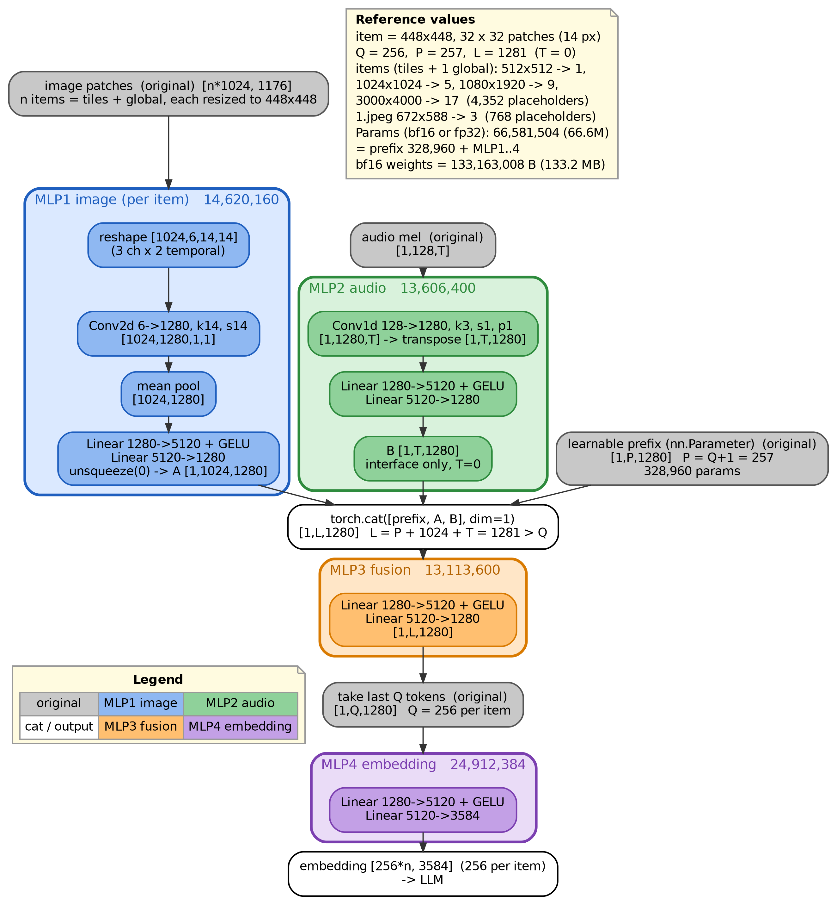

# Fake Encoder

[English](README_EN.md)

随机权重的小模型（66,581,504 参数），替换 Dynamo EPD 部署里 Qwen2.5-VL 的 Encode 段，用于验证 E/P/D 链路、占位数和显存，输出内容没有意义。



## 文件

| 文件 | 说明 |
|---|---|
| `fake_encoder.py` | 模型；`load_or_init`：权重不存在时用 seed=0 生成并保存 |
| `tiling.py` | 切图和 `TilingImageProcessor` |
| `patch_qwen.py` | 替换视觉塔、`get_image_feature` 和图像 processor |
| `encode_entry.py` | encode worker 入口 |
| `audio.py` | 音频分段，独立运行，不接入 Dynamo |
| `launch_fake_disagg.sh` | 启动 frontend + encode/prefill/decode |
| `request_image.sh` | 用 `source/1.jpeg` 发 2 个请求 |
| `launch_utils.sh` | 复制自 `dynamo/examples/common/launch_utils.sh` |
| `.env` | 配置，每项都有注释 |
| `source/` | 示例图片和音频 |

## 快速上手

```bash
uv venv && source .venv/bin/activate
uv pip install --prerelease=allow "ai-dynamo[sglang]==1.6.0"
uv pip install librosa   # 只有 audio.py 需要

bash launch_fake_disagg.sh 2>&1 | tee launch.log   # 终端 A，等三个 worker 都 ready
bash request_image.sh                              # 终端 B，期望两条请求都返回 HTTP 200
python audio.py                                    # 可选：对 source/1.wav 分段，打印段数和每段 [128, frames]
```

权重 `weights/fake_encoder.safetensors`（约 133 MB）首次启动时自动生成。启动前确认 `.env` 里的 GPU 和端口没有被占用。
