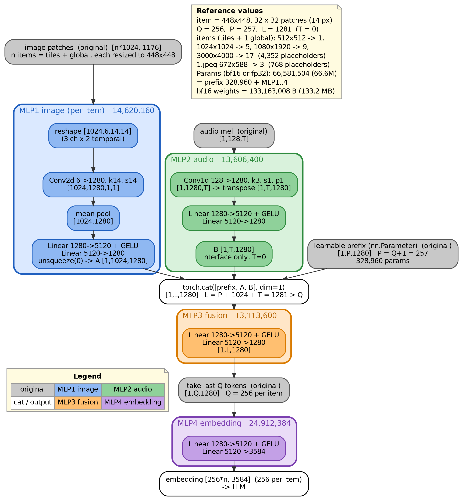

# Fake Encoder

[中文](README.md)

A small model with random weights (66,581,504 parameters) that replaces the Encode stage of Qwen2.5-VL in a Dynamo EPD deployment. It is used to check the E/P/D pipeline, placeholder counts and GPU memory; its outputs carry no meaning.



## Files

| File | Description |
|---|---|
| `fake_encoder.py` | The model; `load_or_init` generates and saves the weights (seed 0) if they are missing |
| `tiling.py` | Image tiling and `TilingImageProcessor` |
| `patch_qwen.py` | Replaces the vision tower, `get_image_feature` and the image processor |
| `encode_entry.py` | Entry point of the encode worker |
| `audio.py` | Audio segmentation; standalone, not wired into Dynamo |
| `launch_fake_disagg.sh` | Starts the frontend and the encode/prefill/decode workers |
| `request_image.sh` | Sends two requests with `source/1.jpeg` |
| `launch_utils.sh` | Copied from `dynamo/examples/common/launch_utils.sh` |
| `.env` | Configuration; every variable is commented |
| `source/` | Sample image and audio |

## Quick start

```bash
uv venv && source .venv/bin/activate
uv pip install --prerelease=allow "ai-dynamo[sglang]==1.6.0"
uv pip install librosa   # only needed by audio.py

bash launch_fake_disagg.sh 2>&1 | tee launch.log   # terminal A; wait until all three workers are ready
bash request_image.sh                              # terminal B; both requests should return HTTP 200
python audio.py                                    # optional: segments source/1.wav, prints the segment count and each [128, frames]
```

The weights `weights/fake_encoder.safetensors` (about 133 MB) are generated on the first launch. Before launching, make sure the GPUs and ports in `.env` are free.
